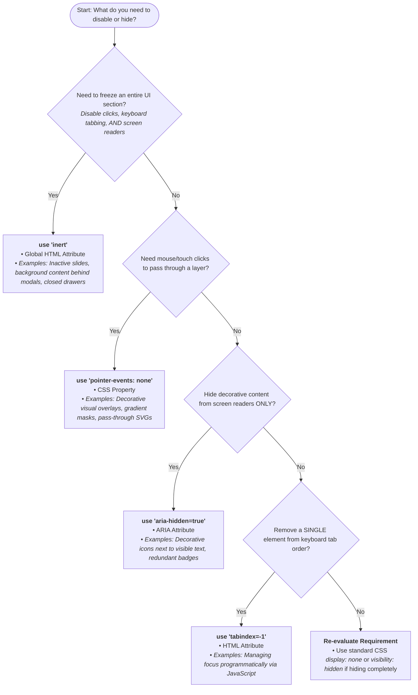

| Feature / Behavior          | pointer-events: none         | tabindex="-1'            | aria-hidden="true" | inert                           |
|-----------------------------|------------------------------|--------------------------|--------------------|---------------------------------|
| Type                        | CSS Property                 | HTML Attribute           | ARIA Attribute     | Global HTML Attribute           |
| Allows Clicks & Touch?      | No                           | Yes                      | Yes                | No                              |
| Allows Keyboard Focus?      | Yes                          | No (Element only)        | Yes                | No (Target + All Children)      |
| Allows Hover Interactions   | No                           | Yes                      | Yes                | No                              |
| Visible to Screen Readers?  | Yes                          | Yes                      | No                 | No                              |
| Cascades to Children?       | Yes (Unless child sets auto) | No (Target element only) | Yes                | Yes (Strict no child overrides) |
| User Can Still Select Text? | Yes (If highlightable)       | Yes                      | Yes                | No                              |

